<p align="center">
  
</p>

<h1 align="center">homtom</h1>

<p align="center">An old TomTom navigator, running our own Linux, as a Home Assistant edge node.</p>

<p align="center">
  
</p>

homtom replaces the stock software on a TomTom GO 630 (Samsung S3C2443, ARM920T) with a mainline-based Linux 6.1 kernel, a BusyBox initramfs and a small set of our own services. The goal is a wall-mounted sensor and display node that reports GPS, battery and power state, takes touch input and talks to Home Assistant. It is a hobby bring-up project on one specific, discontinued device. Parts work, parts are unverified, and a lot is unfinished. Percentages in `docs/STATUS.md` are estimates, not measurements.

Evidence labels used below: "user-reported" means a person at the device saw or heard it; "lab-measured" means a register read, log or test output backs it. See `docs/LESSONS.md` for the dated entries.

## Status

| Area | Label | State and evidence |
|---|---|---|
| Linux 6.1 boots, own board file | Works | `kernel/homtom/`, staged as `ttsystem`; boot logs in `docs/LESSONS.md` |
| USB-ECM network, root shell, FTP | Works | Dev link only: `192.168.1.10`, unauthenticated, see Safety |
| Storage-mode round trip (stage, eject, boot) | Works | Needs an unlocked, awake Mac; the first reboot request is sometimes lost, so the tools retry once |
| Recovery from a bad image | Partial | `ttsystem.prev` plus `tools/homtom-recover` (written but never exercised: every staged image so far booted); intended for images that still reach the bootloader's storage window |
| Watchdog | Partial | Kernel cmdline arms the WDT at boot (WTCON 0x7639, reboot tests run by hand only); a heartbeat-gated feeder resets a wedged userspace. No early-hang test yet |
| INTERNAL (moviNAND) and SD | Works | INTERNAL mounts read-write; SD through `homtom-sdi.ko` |
| LCD frame push, text console, splash | Works | 480x272, RGB565 |
| Backlight PWM | Works | Timer 0 on GPB0 via `homtom-bl`; user-reported steps bright, dim, dimmer, bright |
| Touch | Works | Calibrated with 5 points (fit within 4 px); `targets` test passed 9/9 with max error 8 px (tolerance 12); slide test 3/3. Drawn lines were reported to sit slightly below the finger; not yet analysed |
| Bluetooth radio | Partial | Chip alive; "homtom" is discoverable on an iPhone and a MacBook (user-reported) after setting the crystal frequency; kernel `hci0` is UP RUNNING ISCAN PSCAN (lab-measured) |
| Bluetooth pairing and serial channel | Works | `homtom-btd`: legacy-PIN pairing and an RFCOMM serial channel verified from a Mac (status JSON over Bluetooth). Not yet used as the Home Assistant link; an iPhone cannot open a serial port |
| Sound output | Works | Speaker verified with a Mac microphone: 1 kHz tone raised the level from -81 dB to -43 dB (`homtom-snd2`). A by-ear check is still open; CPU-fed tones distort when other processes run (`docs/AUDIO_DMA.md`) |
| Microphone | Works | 1 kHz spike on codec input select 1, right channel, measured against a Mac speaker; speech-grade capture gain still open |
| GPS | Partial | NMEA sentences arrive at 4800 baud; no fix indoors yet |
| Power key | Works | Short press locks, hold opens the System page, release at 5-10 s powers off, 10 s reboots; verified on the unit (`docs/POWER_KEY.md`) |
| Charging, external power, light | Partial | Raw values read; light sensor needs `LX_EN` raised |
| Battery percent and millivolts | Not yet | The estimate assumes a 1:2 divider and a 1.225 V reference: unverified, treat as a rough number |
| Home Assistant link | Partial | Device JSON over USB, Mac bridge, HA webhook and helpers verified end to end (`docs/HA_LINK.md`, `docs/HA_DASHBOARD.md`); offline alert path is not fully tested |
| Status daemon | Works | `homtom-statusd` (C) answers in 8-40 ms; the shell version took about 2.2 s |
| Trimmed kernel | Partial | zImage 4.43 MB to 3.10 MB; boots with Bluetooth and SD once the modules are rebuilt from the same tree. NO_HZ and high-res timers are held back |
| Panel (Home Assistant tiles on the LCD) | Partial | `panel/`, `gateway/` and `emulator/` exist; see their sources and `docs/GATEWAY_API.md` |
| Motion sensors, FM, RTC, USB host | Not yet | Motion sensors are probably not fitted; the others are unexplored (`docs/PERIPHERALS.md`) |
| Full flash backup and tested recovery from a dead bootloader | Not yet | NOR dumps exist but no write-back has been verified; see `docs/RECOVERY.md` |
| Boot logo in NOR | Works, risky | Black logo replacing the hand logo written and verified by a separate dump; earlier NOR writes froze the unit twice, so this stays discouraged (`docs/flash-safety.md`, `docs/NOR_REVIEW.md`) |
| Cleanup of debug hooks | Not yet | Phase 9 of `docs/ROADMAP.md` |

## How we debugged it with nothing

The GO 630 has no serial console, no JTAG header we could find, no network at first boot and nothing on the screen until a system is already running. When the first kernel simply stopped, the device gave no hint why. The only output channel was the LCD, so we taught it to speak, one step at a time. The same approach later found the bootloader's storage-mode behaviour (`docs/LESSONS.md`).

**1. Colours as breakpoints.** The first thing a kernel can do is paint the framebuffer a solid colour. One colour per boot stage: white entering the kernel, cyan once the machine type is recognised, yellow before memory setup, orange inside it. The colour left on screen is the last stage that worked, so the crash is in whatever comes next. Stages were then split finer, again and again, like bisecting with a paintbrush.

<p>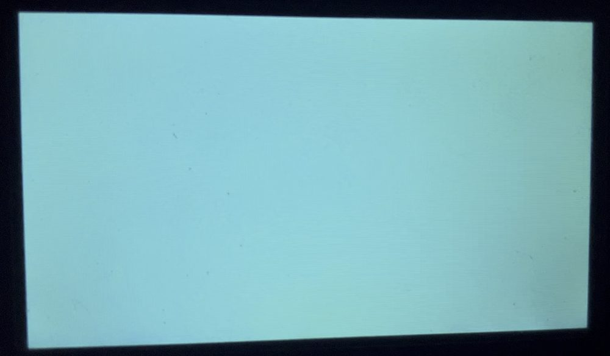<br><sub>One solid colour is one stage reached. Pale cyan: the machine was recognised, the crash is after it.</sub></p>

**2. Flashing bits.** A colour says where, not what. To read a value the screen blinked it out: short flashes for ones, another colour for the gaps. It worked and was painfully slow.

**3. Squares.** Bits drawn as squares, black for 0 and white for 1, in rows with a coloured bar per group. A whole register fits in one photo instead of a minute of watching.

<p>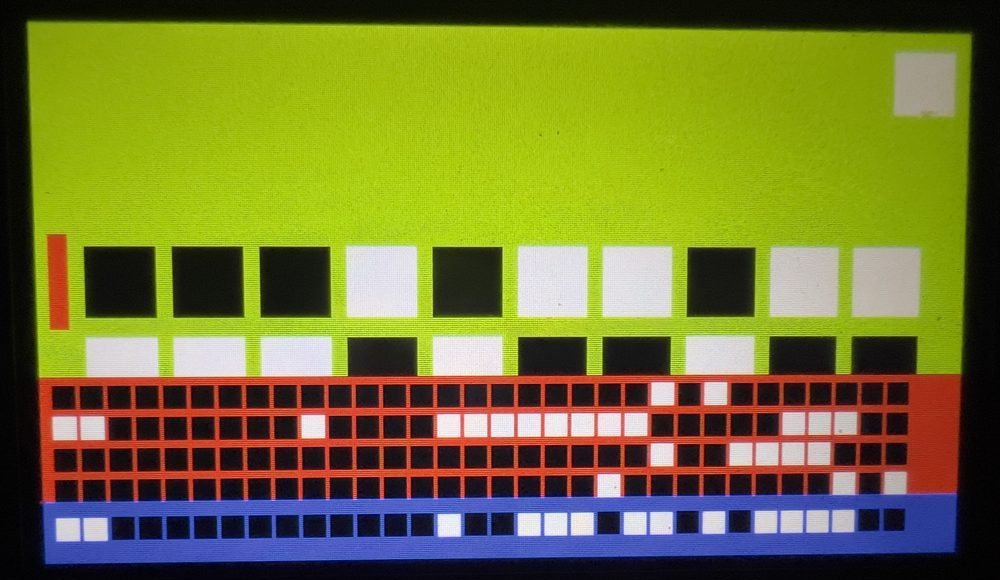<br><sub>Bits as squares, read from a photo of the screen.</sub></p>

**4. Hexadecimal digits.** A small pixel font draws real hex digits, so the screen can show register values and addresses directly.

<p>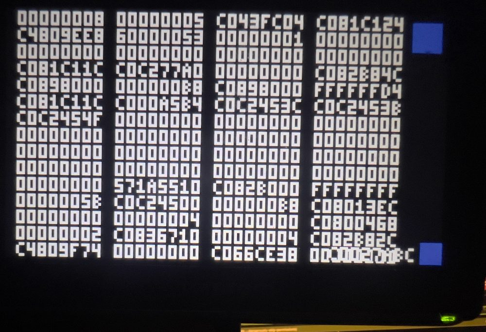 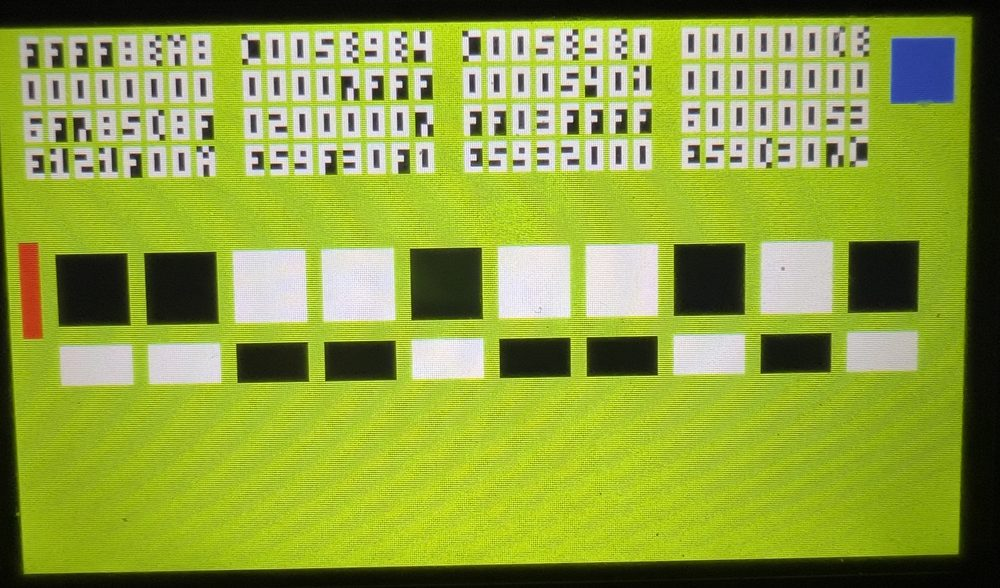<br><sub>Digits, and digits plus squares while the two methods overlapped.</sub></p>

**5. Letters, then a text console.** Once digits exist, letters are more glyphs. A text console let the kernel say, in words, what memory it found, which drivers started and when it handed over to the first program.

<p>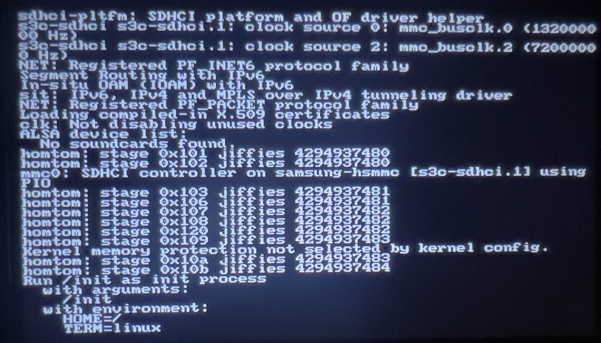<br><sub>The kernel speaks in sentences and starts init.</sub></p>

**6. USB network and a shell.** After that came a USB gadget network link (ECM) and a root shell, and the loop became normal development: build, stage over the bootloader's storage mode, boot, read logs.

<p>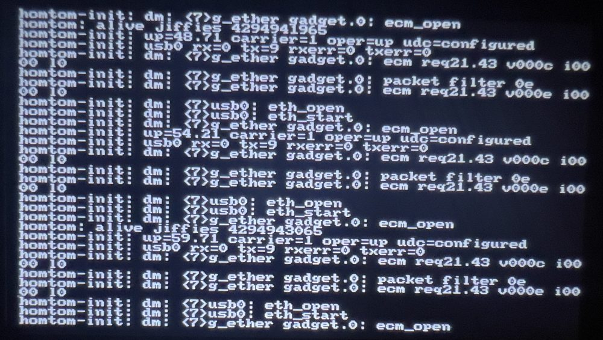<br><sub>First sign of the network link, from here on with a shell.</sub></p>

Lesson learned along the way: the debugging aids can break things too. At one point the colour markers added to find a crash were the crash, because one clobbered a register at the wrong moment. They are now compiled out unless a bug is being hunted.

## Where it ended up

The unit boots to its own splash and then a Home Assistant panel for the room it hangs in: heating, lights, presence, air quality and ventilation, with live state from the house.

<p>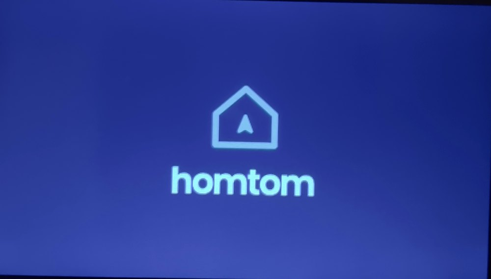 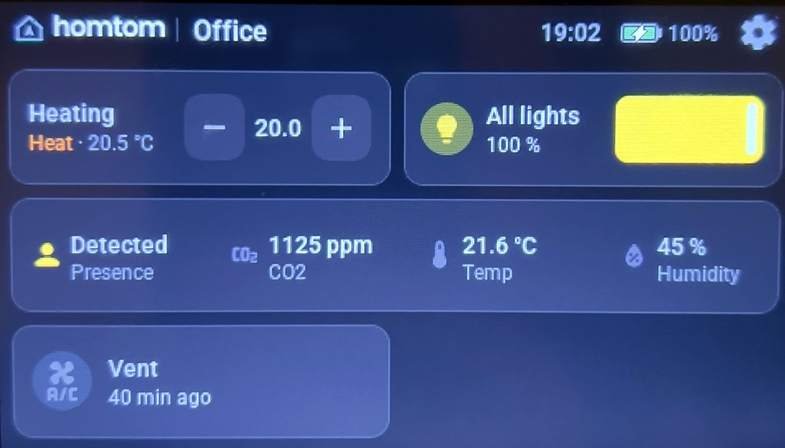</p>

More screens are in [`docs/images/screens/`](docs/images/screens/README.md) (on-device screenshots and host renders, labelled) and the UI design mockups in [`docs/ui-mockups/`](docs/ui-mockups/README.md).

## Inside the unit

Seven annotated photos of an opened GO 630 (chip markings kept, serial stickers and the battery label blurred, metadata stripped). Analysis, component table and JTAG/UART leads: [`docs/BOARD_PHOTOS.md`](docs/BOARD_PHOTOS.md).

<p>
  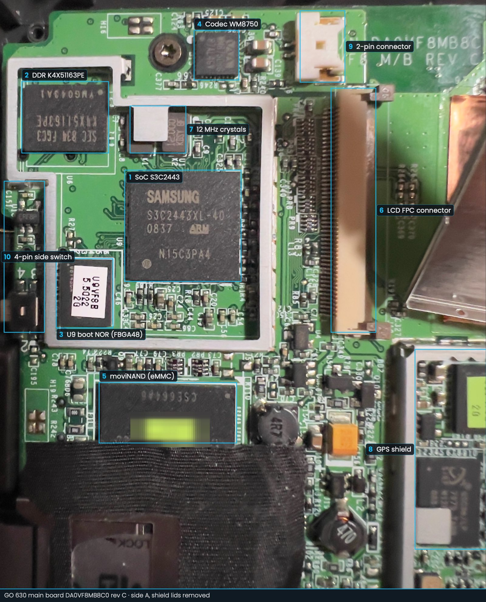
  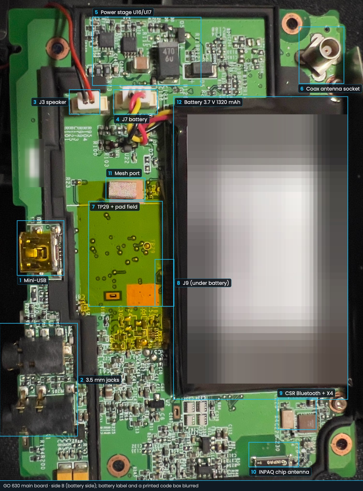
</p>
<p>
  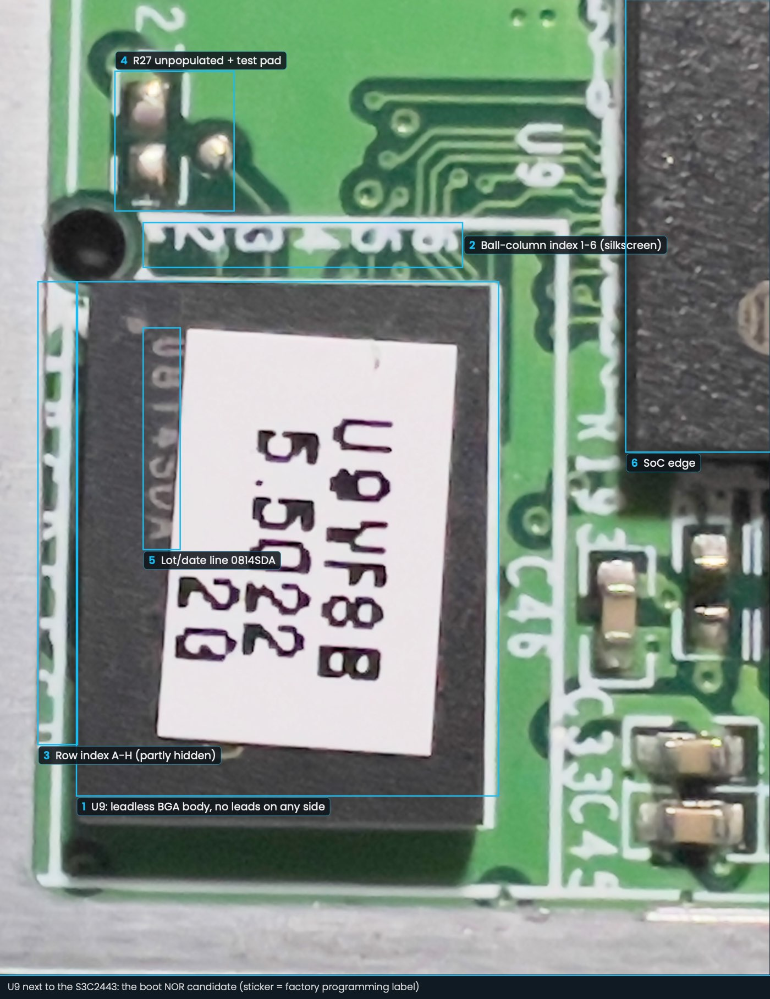
  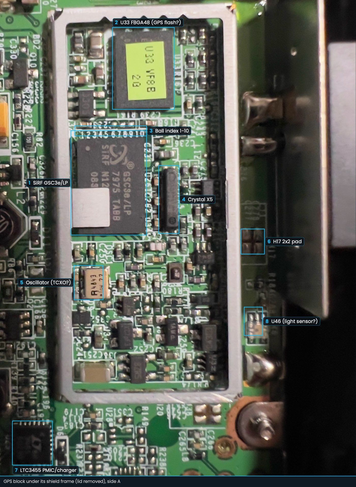
  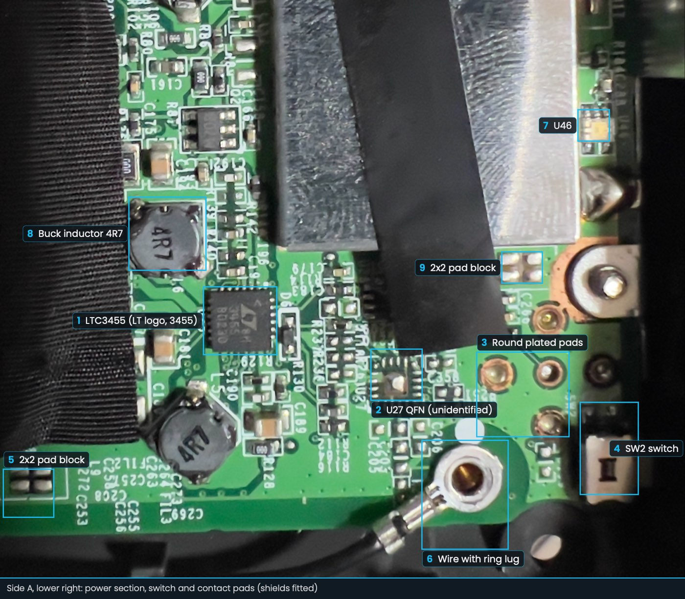
  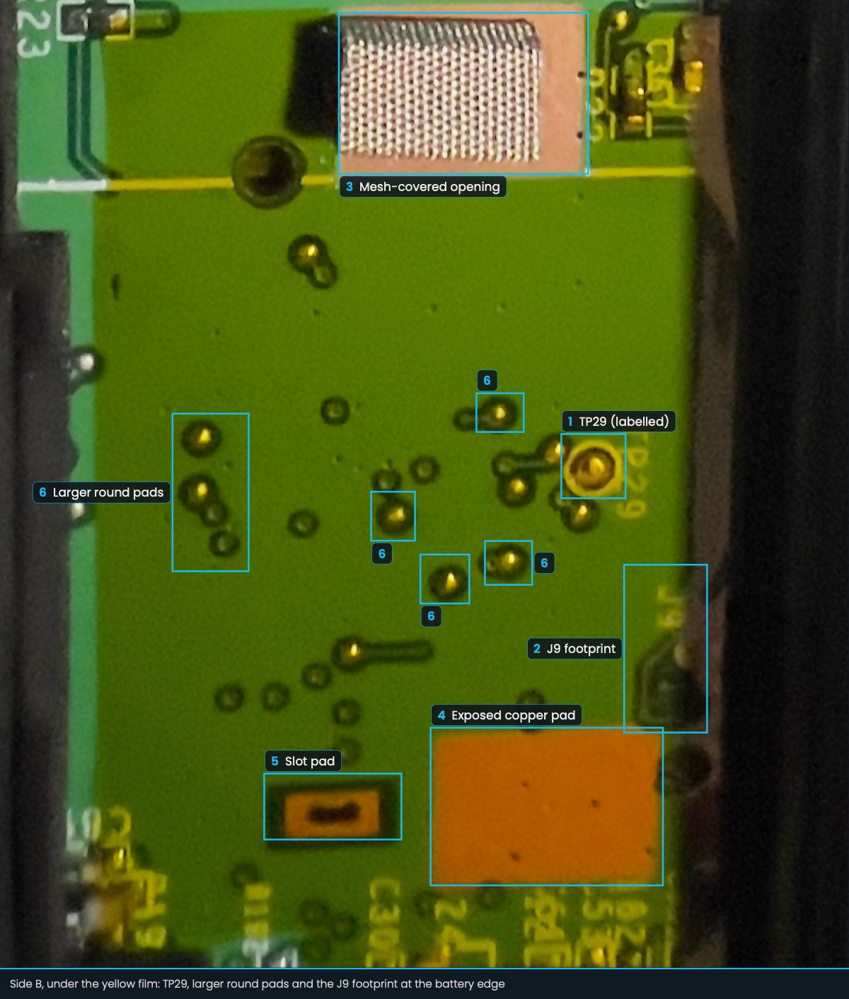
</p>

Findings in short: the boot NOR (U9) is a leadless FBGA48, so an external read means JTAG or BGA rework; a second flash (U33) sits in the GPS shield; no labelled JTAG or UART pads are visible.

## Honest limits

- The power-on hand logo and the storage-mode screens are images in the bootloader's NOR flash, drawn before any file is read. They cannot be replaced by changing files on INTERNAL. Replacing them needs a NOR write, which has frozen the unit twice and, once hardened, succeeded for the black power-on logo (`docs/flash-safety.md`, `docs/NOR_REVIEW.md`). This project does not recommend writing NOR. Storage-mode screens are still stock. What you see at power-on is the (black or stock) logo, then the homtom splash from INTERNAL, then the kernel console.
- We never replace the bootloader. We replace the `ttsystem` image it loads.
- Battery percent, sound audibility and Bluetooth pairing are unverified, as marked above.
- The board has no buzzer, camera or barometer (`docs/PERIPHERALS.md`).
- All dev-link services are unauthenticated and meant for a cable between your Mac and the unit only.

## Hardware

| Part | Detail |
|---|---|
| Device | TomTom GO 630 |
| SoC | Samsung S3C2443, ARM920T (ARMv4T) |
| RAM | About 64 MB |
| Storage | 512 KiB NOR (bootloader), moviNAND as INTERNAL, SD slot |
| Display / input | 480x272 LCD, resistive touch |
| Radio | CSR BlueCore4 Bluetooth 1.2 (BCSP over UART) |
| GPS | On-board receiver on a UART |
| Audio | WM8750-class codec, speaker and microphone |

Evidence per item: `docs/HARDWARE_MAP.md`. Some board facts came from the device owner and were not re-measured; `docs/HARDWARE.md` keeps that distinction.

## Architecture

One page with the boot chain, services, USB link and Home Assistant path: [`docs/ARCHITECTURE.md`](docs/ARCHITECTURE.md).

## Safety

This can brick the unit. A damaged bootloader in NOR can only be recovered with JTAG or an external programmer.

- Never write `INFORM0=3`: the bootloader's first stage may then jump to whatever is in `INFORM1`. The working value is 5, set by the init script.
- No raw disk commands against the unit's storage or NOR. Stage files only through the tools in `tools/`.
- Do not write NOR flash. See `docs/flash-safety.md` for the incident.
- Keep `ttsystem.prev` on INTERNAL and run `tools/homtom-mark-good` after each verified boot (staging keeps the last good image as the fallback until then). If a staged image does not boot, run `tools/homtom-recover` (untested in a real failure); it waits for the bootloader's storage window, restores `ttsystem.prev`, verifies the copy and ejects.
- Run `caffeinate -dimsu` on the Mac during staging. Storage mode only appears when the Mac is awake and unlocked, so unattended staging is unreliable.
- Do not toggle USB soft-connect on the gadget; it leaves USB dead until reboot. Use plain `reboot` on the device, not `reboot -f`.
- Ship kernel modules built from the same tree as the zImage; mismatched modules fail to load (`docs/LESSONS.md`).
- Telnet, the raw shell on port 2323 and anonymous FTP are open on the USB link. Do not bridge that link onto a network you do not trust.

You do this at your own risk, on hardware you can afford to lose. A tested recovery from a dead bootloader does not exist.

## Dev loop

You need the unit, a USB cable, a Mac and Docker. First-day walkthrough: [`docs/QUICKSTART.md`](docs/QUICKSTART.md).

```sh
tools/homtom-state                 # one-line state: LINUX, STORAGE or down (read-only)
tools/homtom-sh 'uname -a' 10      # command on the device shell; second argument is the timeout
tools/homtom-put LOCAL /tmp/NAME   # upload over the USB link

tools/homtom-to-storage            # reboot into the bootloader's storage mode
tools/homtom-stage FILE            # copy FILE to INTERNAL as ttsystem, keep the previous as ttsystem.prev
tools/homtom-to-linux              # eject; the bootloader boots the staged image
```

The round trip is: Linux, storage mode, stage, eject, Linux. Loadable modules and device tools can also be pushed with `tools/homtom-put` and loaded without a reboot. `tools/homtom-stage-live` stages from a running Linux with no storage mode; it is riskier and guards on INTERNAL being the right card.

## Build

```sh
kernel/scripts/docker-build.sh                      # kernel zImage (arm-linux-gnueabi in Docker)
kernel/scripts/build-modules-tree.sh TREE OUTDIR    # modules from the SAME kernel tree as the zImage
tools/devtools/build.sh [tool ...]                  # freestanding ARMv4T device tools (docker)
MODDIR=OUTDIR ZIMAGE=path/to/zImage OUT=path/to/outdir \
  kernel/scripts/build-ttsystem-6.1.sh              # wrap zImage plus initramfs as ttsystem
```

`docker-build.sh` honours `TREE` (kernel source, default `.runtime/linux-6.1`) and `OUT`. `build-ttsystem-6.1.sh` defaults `ZIMAGE` and `OUT` to `artifacts/kernel-builds/homtom-6.1` and `MODDIR` to `artifacts/modules-6.1`, and refuses to build without matching modules. Build outputs go under `artifacts/` (gitignored). `docs/LESSONS.md` records pitfalls, for example that a full `make modules` fails on macOS because of case-insensitive filenames, so modules are built per directory in Docker.

## Repo map

| Path | Contents |
|---|---|
| `kernel/` | Board file and defconfig (`homtom/`), out-of-tree module (`modules/homtom-sdi`), build scripts (`scripts/`) |
| `userland/` | On-device shell scripts: Bluetooth bring-up and start, shell listener, legacy status and GPS |
| `tools/` | Mac-side dev-loop scripts (`homtom-*`), the HA bridge, and `devtools/` (C sources and binaries for device tools: statusd, btd, touch, backlight, sound, HCI) |
| `workspace/` | Sources and experiments: GUI (`gui/`), status daemon, touch, Bluetooth, audio, kernel trim, boot graphics |
| `panel/`, `gateway/`, `emulator/` | On-device Home Assistant tile panel, the Mac-side gateway that feeds it, and a userspace emulator |
| `firmware/` | Bootloader image tooling (`ttimage.py`, `norimage.py`, bootsplash) and overlay files |
| `brand/` | Mark, icon, fonts, splash renderers and images (`brand/README.md`) |
| `docs/` | Status, roadmap, hardware map, lessons, safety, recovery, Home Assistant notes; `docs/images/` holds this README's images |
| `scripts/`, `tests/` | Release helpers (`public-export.sh`, `public-scan.sh`, `make-release.sh`), the Mac-side `tt.py`, and host-only unit tests |

Start reading at `docs/STATUS.md`, `docs/ARCHITECTURE.md` and `docs/ROADMAP.md`.

## Contributing

Issues and notes from anyone with the same hardware are welcome, especially independent confirmation of pin mappings, Bluetooth pairing and sound. Keep claims tied to evidence: record lessons in `docs/LESSONS.md` as symptom, cause, fix. Do not include personal data (usernames, paths, serials, addresses, Bluetooth addresses, webhook ids) in commits or logs. Commit subjects are short and imperative.

## Licence

- Linux kernel patches, board file and kernel modules (`kernel/`): GPL-2.0-only.
- Other code (`userland/`, `tools/`, `panel/`, `gateway/`, `emulator/`, `firmware/`, scripts): MIT, see `LICENSE`.
- Brand artwork (`brand/`): CC-BY-4.0, see `brand/LICENSE`. Poppins fonts: SIL OFL 1.1, `brand/fonts/OFL.txt`.
- Third-party sources keep their own licences, listed in `NOTICE`.

TomTom is a trademark of its owner. This project is not affiliated with or endorsed by TomTom and ships no TomTom software, maps or firmware. See [`SAFETY.md`](SAFETY.md) before touching a unit and [`CONTRIBUTING.md`](CONTRIBUTING.md) to help.
